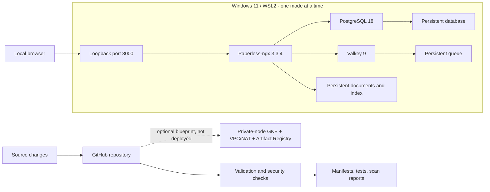

# Paperless GCP DevOps Platform

Deployment and operations configuration for [Paperless-ngx](https://github.com/paperless-ngx/paperless-ngx), with Docker Compose, Minikube/Helm, and an optional Google Cloud Terraform blueprint.

The local stack runs Paperless-ngx, PostgreSQL, and Valkey with pinned images, persistent storage, health checks, and resource limits for a Windows 11/WSL2 host. Cloud infrastructure is disabled by default; validation and mock tests run without cloud credentials or provisioned resources.

Paperless-ngx is an upstream dependency. This repository contains the deployment configuration, automation, tests, and operations documentation. See [attribution and licenses](THIRD_PARTY_NOTICES.md).

## Documentation

| Task | Documentation |
|---|---|
| Set up locally | [Windows/WSL2 setup](docs/windows-wsl2.md) |
| Deploy, troubleshoot, and restore | [Runbook](docs/runbook.md) |
| Understand the design | [Architecture](docs/architecture.md) and [decisions](docs/decisions.md) |
| Run and review checks | [Validation record](docs/evidence/VALIDATION.md), [checklist](docs/evidence/CHECKLIST.md), and [workflows](.github/workflows) |
| Inspect the cloud configuration | [Terraform blueprint](terraform/README.md) |
| Review security findings | [Security model](SECURITY.md) and [image scan](docs/evidence/image-scan-summary.md) |

## Components

- **Reproducibility:** the same three upstream image digests in Compose and Helm, tracked in [images.lock.json](images.lock.json).
- **Operations:** health checks, persistent storage, restricted local access, resource budgets, failure diagnosis, and an export/restore drill.
- **Kubernetes:** an original chart with non-root containers, single-writer storage, external Secrets, probes, resource requests/limits, and retained PVCs.
- **Infrastructure as code:** reusable network, GKE, and Artifact Registry modules; private nodes, scoped node IAM, and an explicit deployment opt-in.
- **Continuous validation:** schema validation, policy regression tests, mocked Terraform plans, workflow linting, committed-secret scanning, and image vulnerability/SBOM workflows.

This is a single-node lab. High availability, internet exposure, and automated cloud delivery are outside its scope. GitHub Actions is configured for validation, security scans, and disposable runtime tests; no workflow applies the Google Cloud blueprint.

## Architecture



Compose binds only to `127.0.0.1`. Kubernetes exposes ClusterIP services, reached through a loopback-only port-forward. No ingress or public load balancer is created. [Detailed architecture and boundaries](docs/architecture.md).

## Verification status

Local static checks and Terraform mock tests passed. Compose and Minikube runtime tests remain pending, and the Google Cloud blueprint has not been applied. Commands, tool versions, and results are recorded in the [validation record](docs/evidence/VALIDATION.md).

The dated [image scan](docs/evidence/image-scan-summary.md) found HIGH/CRITICAL advisories in the upstream Paperless and PostgreSQL images. The image-security gate fails on those findings. Review them before using real documents or considering exposure beyond this synthetic local lab.

| Component | Status |
|---|---|
| Compose setup | Configuration validated; startup and ingestion pending |
| Minikube/Helm | Chart linted, rendered, schema and policy checked |
| GCP Terraform | Provider-validated and tested with mocks; never applied to GCP |
| GitHub Actions | Definitions linted locally; first hosted validation run blocked before execution |
| Image security | Scans completed; HIGH/CRITICAL findings remain in Paperless and PostgreSQL |

## Quick start: Compose

Use an Ubuntu **WSL2 Bash terminal**, with Docker Desktop's WSL integration enabled. Complete [prerequisites](docs/windows-wsl2.md) first. Keep the repository in the WSL Linux filesystem and run from its root.

```bash
python3 scripts/init_local.py
docker compose config --quiet
docker compose up -d --wait --wait-timeout 900
docker compose exec webserver createsuperuser
```

Open **http://localhost:8000** and use the administrator you just created. Credentials are generated locally; there is no default password. Test the pipeline with a synthetic document:

```bash
python3 scripts/smoke.py
docker stats --no-stream
docker compose stop
```

The test prompts for credentials, uploads a tiny original PDF, waits for searchable extracted text, and checks the downloaded original's SHA-256. It retains that synthetic document for restart/restore exercises. This proves text extraction when run; it is **not an OCR accuracy or throughput benchmark**.

## Memory budget: 8 GB Windows laptop

Run Compose **or** Minikube, sequentially. Close memory-heavy apps. Suggested WSL ceiling: 4 GB RAM, 2 CPUs, 2 GB swap; Minikube allocation: 3 GB inside that ceiling. These are starting budgets, not measured minimum requirements.

| Workload | Memory limit | CPU limit |
|---|---:|---:|
| Paperless app and bundled workers | 1,536 MiB | 1 CPU |
| PostgreSQL | 384 MiB | 0.5 CPU |
| Valkey | 128 MiB | 0.25 CPU |
| Total application limits | 2,048 MiB | 1.75 CPU |

Kubernetes, Docker and WSL need additional memory. OCR is limited to one task and one thread. Office conversion, an AI service, and a Prometheus/Grafana stack are deliberately outside this laptop profile. Start with one small synthetic PDF; review actual `docker stats`/OOM events before increasing load. Keep at least 15–20 GB of free disk for images, the node, and test data; image sizes may grow.

## Validate without deploying

Requirements: Python 3.10+, Docker CLI/Compose, Helm 3.19+ or compatible Helm 4, Terraform 1.7+ (CI pins 1.13.5), internet access for public tools/schemas/providers. No Docker daemon, GCP account, billing account, or cloud credentials are required for this path.

```bash
python3 -m venv .venv
source .venv/bin/activate
python -m pip install -r requirements-dev.txt
python scripts/install_ci_tools.py actionlint kubeconform
export PATH="$PWD/build/tools:$PATH"
actionlint -shellcheck="" .github/workflows/*.yml
python scripts/validate.py
```

`terraform test` uses `mock_provider "google"`; its `command = apply` evaluates simulated resources only. Do not replace that command with `terraform apply`.

## Repository map

```text
compose.yaml                  Local three-service stack
helm/paperless/                Original Minikube Helm chart
helm/values-gke.yaml           Future GKE disk-class overlay
terraform/modules/            Reusable network, gke and registry modules
terraform/tests/              Credential-free mock tests
.github/workflows/            Validation, security and manual runtime demos
scripts/                      Initialization, validation and API smoke tools
tests/                        Secret handling and deployment-policy regressions
docs/                         Setup, runbook, architecture and validation records
LICENSES/                     Referenced upstream license texts
```

## Validation and maintenance

Use the [validation checklist](docs/evidence/CHECKLIST.md) when changing workload settings or image digests. Run the static checks, then the Compose and Minikube runtime tests separately. Record the commit, environment, and results alongside sanitized test artifacts. The Terraform blueprint can remain undeployed.

## License

Original repository material is MIT licensed. Paperless-ngx remains GPL-3.0-only; its image is consumed unchanged from upstream. PostgreSQL and Valkey retain their own licenses. [Full attribution](THIRD_PARTY_NOTICES.md).
