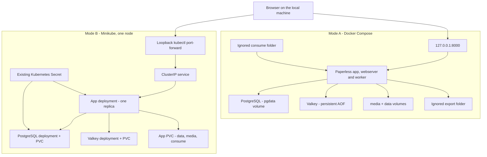
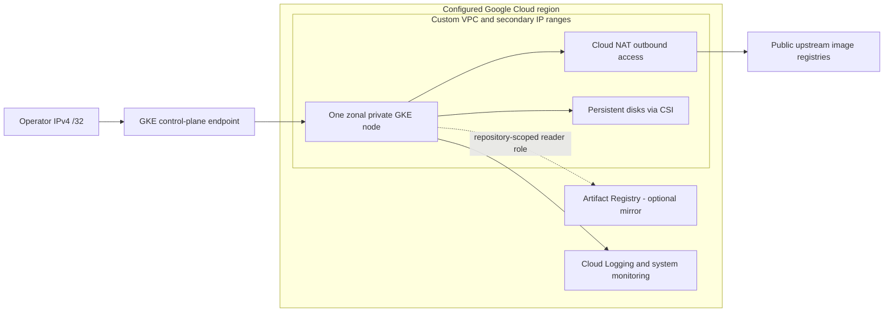

# Architecture and trust boundaries

The laptop runs the same workload in two alternatives. The Helm chart does not connect to the Compose database. Each environment has independent storage and administrator accounts. Local credentials may be copied to the Kubernetes Secret by the helper, but that does not migrate data.

The application uses PostgreSQL for metadata, a Redis-compatible Valkey broker for background work, and filesystem storage for originals, derived files, and its index. A healthy login page alone does not prove background processing. The smoke test checks ingestion through the API, text extraction, search, and byte-for-byte recovery of the original.

## Future Google Cloud blueprint — not deployed

Private nodes have no external node IPs. The control-plane public endpoint is limited to one supplied operator `/32`; it is not an application endpoint. NAT permits private-node image pulls and is billable. Workload Identity Federation for GKE is enabled, but this application receives no Google IAM grants because it does not call Google APIs. The node account has the documented GKE node role plus read access to this project's registry only.

The optional registry starts empty. The chart still pulls the pinned upstream images. No mirroring, image publishing, credentials exchange, or GCP authentication occurs in Actions. If a future operator mirrors upstream images, preserve the corresponding source/license obligations and update image digests based on the mirror's manifest.

## Storage and availability

App, PostgreSQL and broker each use one writer. `Recreate` deliberately permits downtime during an upgrade and avoids overlapping writers on RWO volumes. A larger replica count is not a valid scaling change for this chart. Minikube's host-path disks are local to the node; PVC retention cannot protect against deleting the Minikube profile. Export off the node before deletion.

## Security boundary

Loopback access is for the local user. It is not TLS, a firewall policy, or isolation from a compromised host. Kubernetes pods use non-root IDs, dropped capabilities, seccomp, no privilege escalation and no service-account-token mount. The lab has no NetworkPolicy, external secret manager, dedicated tenant isolation, or encrypted backup automation. Those are explicit future work, described in [security](../SECURITY.md).
